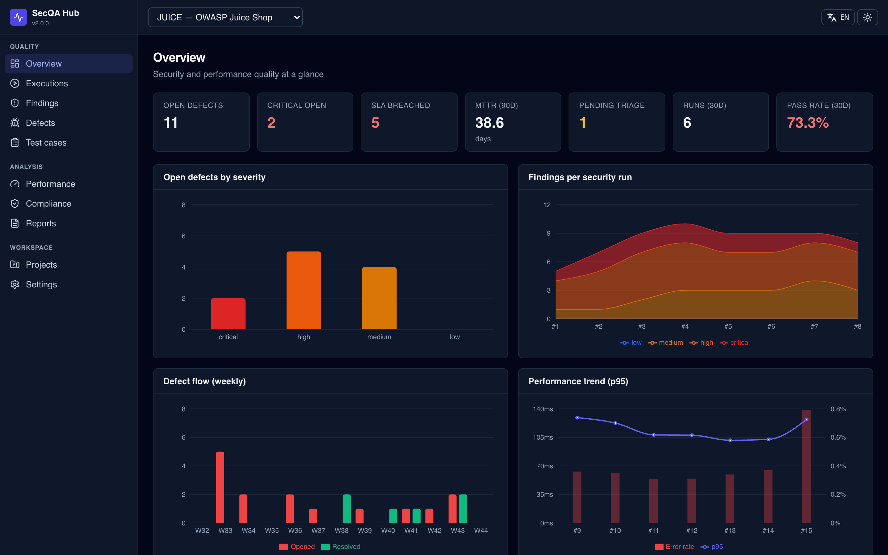

<div align="center">

# 🛡️ SecQA

### Tu pentester y tester de performance con IA, con un gestor de defectos de verdad detrás

SecQA convierte **Claude Code** en un ingeniero de QA de seguridad y performance para cualquier repositorio.<br>
Encuentra las vulnerabilidades, las demuestra con capturas, hace pruebas de carga y sigue cada problema hasta cerrarlo en un Hub propio.

[](https://github.com/GonzaloAlarconRoldan/SecQA/actions/workflows/ci.yml)
[](LICENSE)
[](https://github.com/GonzaloAlarconRoldan/SecQA/stargazers)

[English](README.md) · [Arquitectura](docs/architecture.md) · [Integraciones](docs/integrations.md) · [Despliegue](docs/deployment.md)



</div>

## ¿Por qué SecQA?

Correr un escáner es fácil. **Lo difícil es todo lo demás**:
- elegir las herramientas adecuadas para cada stack;
- saber cuáles de 300 alertas importan hoy;
- demostrarle el problema a quien lo tiene que arreglar;
- asegurarse de que no vuelva.

SecQA cubre todo ese ciclo. Así resume una ejecución:

> **2 vulnerabilidades explotadas activamente (CISA KEV):** `log4j-core@2.14.1` → actualizar a **2.15.0**.<br>
> **SQL injection en `POST /login`:** capturas de antes y después muestran el acceso como admin con `' OR 1=1--`.<br>
> **IDOR:** con la misma sesión, cambiar `?id=2` por `?id=3` muestra la dirección de otro cliente (enmascarada en la evidencia).<br>
> **Performance:** el p95 de `GET /search` subió un 88 % frente al baseline, así que se abrió un defecto de regresión automáticamente.

## Qué incluye

- **Skills de Claude Code** que eligen herramientas según el stack y se detienen si algo está fuera de scope: `/pentest-run`, `/perf-test`, `/pentest-report`…
- **Hub web multi-proyecto**:
  - dashboard con KPIs (defectos abiertos, SLA vencidos, MTTR, pass rate),
  - ejecuciones con su detalle,
  - triage de hallazgos en lote,
  - gestor de defectos e incidentes (tabla + kanban, comentarios, adjuntos, historial),
  - repositorio de casos de prueba,
  - tendencias de performance,
  - matriz de cumplimiento OWASP / ISO 27001,
  - reportes HTML/PDF en ES/EN.
- **Inteligencia de vulnerabilidades en cada ejecución**: `secqa detect` saca las versiones exactas de los lockfiles y `secqa intel` las cruza con **OSV.dev / GitHub Advisories**, **CISA KEV** (lo explotado activamente pasa a crítico), **EPSS** y los CVEs que **NVD** publicó para tu stack en los últimos 30 días. Además, el agente revisa los avisos oficiales de cada fabricante.
- **Evidencia visual**: `secqa capture` toma capturas de cómo se ve el problema, por ejemplo un SQLi que entra como admin o un id cambiado en la URL que muestra datos ajenos. Resalta la prueba, enmascara solo emails, hashes y tokens, y añade una franja con URL, hora y run. Las capturas de antes y después pasan del hallazgo al defecto y al PDF.
- **Memoria de decisiones**: los falsos positivos siguen suprimidos en próximas runs, y si un hallazgo de un defecto cerrado reaparece, el defecto se reabre solo.
- **Performance con baseline**: perfiles k6 (smoke, load, stress, spike, soak) limitados por `scope.yml`. Métricas por endpoint, detección automática de regresiones y un defecto abierto cuando hay regresión. También importa resultados de JMeter.
- **Formatos estándar**: SARIF, k6, JMeter JTL, JUnit → Hub → HTML/PDF, CSV, SARIF para GitHub.
- **Seguro por defecto**: solo objetivos autorizados, tope de usuarios virtuales en las pruebas de carga, auditoría de cada comando activo, secretos enmascarados, y reportes que solo contienen datos validados por una persona.

## Inicio rápido

### Pruébalo en 60 segundos, sin Docker

```bash
git clone https://github.com/GonzaloAlarconRoldan/SecQA && cd SecQA
pip install -e ".[hub]"
secqa demo seed && secqa hub serve   # → http://127.0.0.1:8787 con 12 semanas de datos realistas
```

Para probar un ataque real, `python examples/vuln-lab/app.py` levanta una tienda pequeña y vulnerable a propósito en `127.0.0.1:5055`.

### Demo con Docker (2 minutos)

```bash
git clone https://github.com/GonzaloAlarconRoldan/SecQA && cd SecQA
docker compose -f examples/demo/docker-compose.yml up --build
```

Abre **http://127.0.0.1:8787**. El Hub viene con 12 semanas de historial de OWASP Juice Shop, que corre en `127.0.0.1:3000` como objetivo real.

### En tu proyecto

```bash
pip install "secqa[hub] @ git+https://github.com/GonzaloAlarconRoldan/SecQA"
secqa hub serve
secqa doctor --install              # instala semgrep, gitleaks, osv-scanner y k6 (pregunta antes)
secqa init /ruta/a/tu-proyecto --project SHOP
cd /ruta/a/tu-proyecto
secqa project create SHOP --name "Shop API"
cp scope.yml.example scope.yml      # hosts permitidos, límites de carga, quién autoriza
```

Y en Claude Code: `/secqa-setup` (prepara herramientas, Hub y scope), `/pentest-run`, `/perf-test`, `/pentest-report`.

## Uso responsable

Prueba **solo** sistemas propios o para los que tengas autorización explícita. Las fases activas exigen un `scope.yml` con los objetivos permitidos y quién los autoriza. Las pruebas de carga solo corren contra hosts locales o propios, con tope de `max_vus`, y los perfiles pesados piden confirmación cada vez. Ver [SECURITY.md](SECURITY.md).

## Licencia

[MIT](LICENSE) © Gonzalo Alarcón Roldán

---

<div align="center">

Si SecQA te ahorra tiempo, dale una ⭐ al repo: ayuda a que otros ingenieros de QA y seguridad lo encuentren.

</div>
