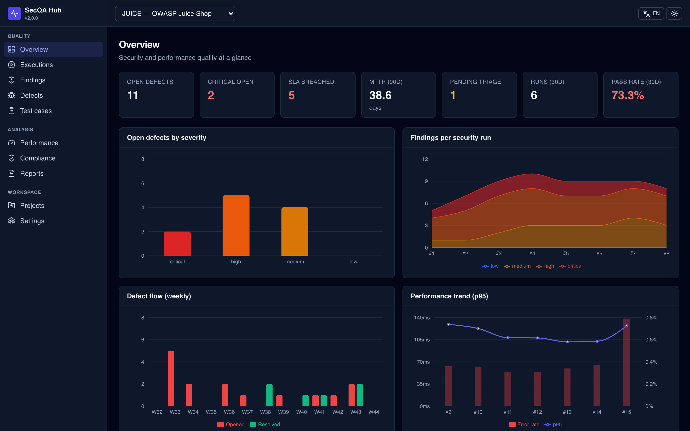
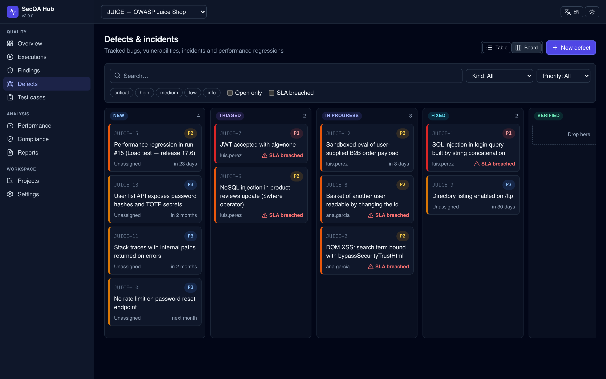
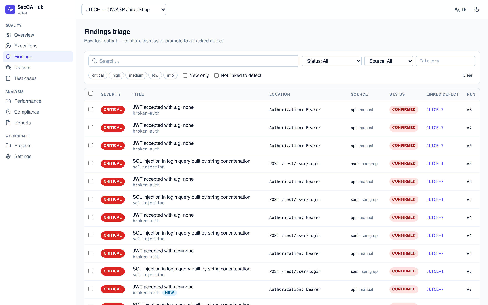
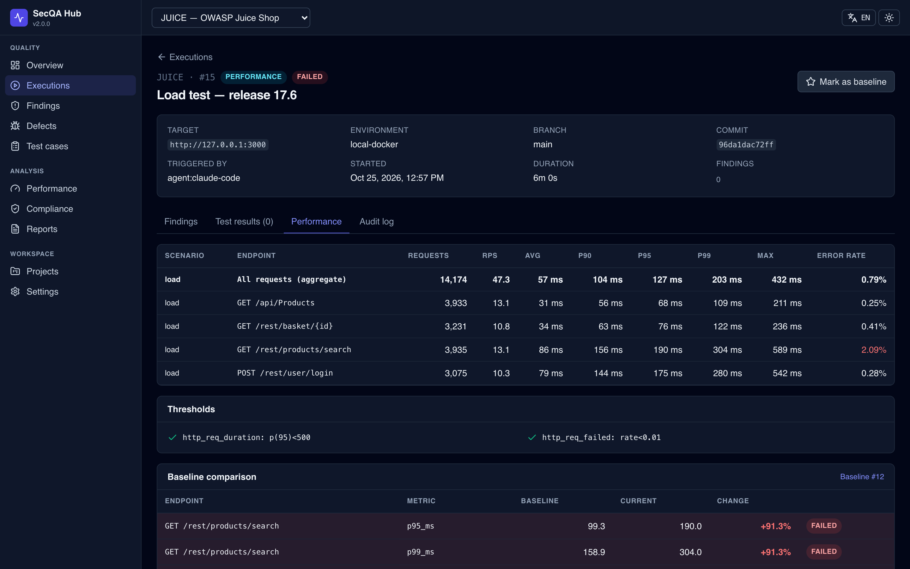
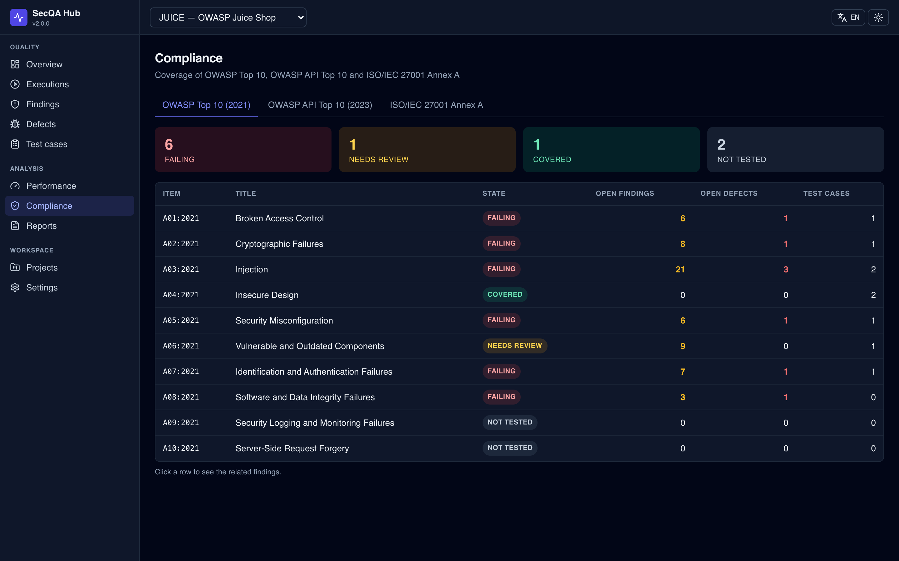
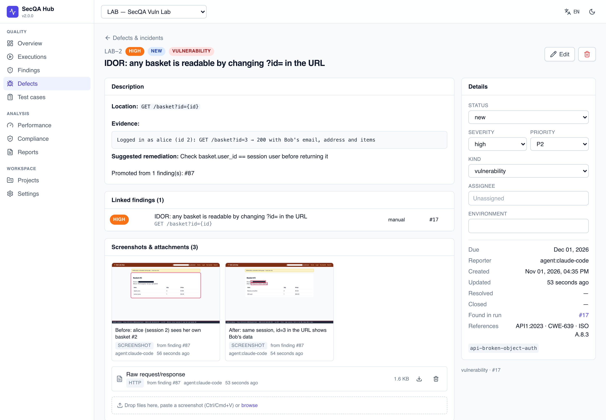
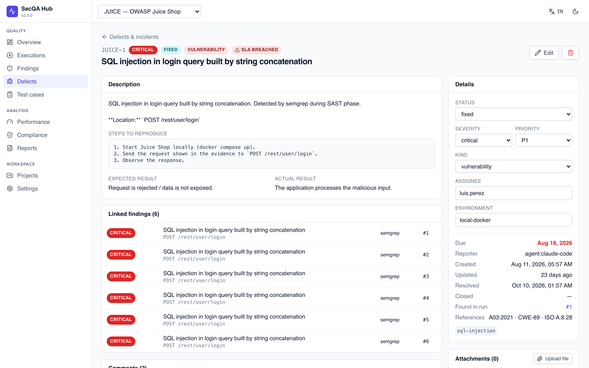

<div align="center">

# SecQA

**AI-assisted security & performance QA for Claude Code — with a central Hub for runs, test cases and defects.**

[](https://github.com/GonzaloAlarconRoldan/SecQA/actions/workflows/ci.yml)
[](https://github.com/GonzaloAlarconRoldan/SecQA/actions/workflows/codeql.yml)
[](LICENSE)


[Español](README.es.md) · [Architecture](docs/architecture.md) · [Integrations](docs/integrations.md) · [Deployment](docs/deployment.md)



</div>

SecQA turns Claude Code into a security and performance tester for any repository. It detects the stack, runs the right scanners (SAST, SCA, secrets, API, DAST) and k6 load tests. Everything it finds lands in the **SecQA Hub**, where people triage findings, track defects against SLAs and watch trends across runs.

```
/pentest-run        →  recon · intel (OSV · KEV · EPSS · NVD) · SAST · SCA · secrets · API · DAST  →  findings
/perf-test          →  k6 smoke / load / stress against a baseline →  latency, throughput, regressions
                                     │
                              secqa CLI (validated)
                                     ▼
            SecQA Hub — executions · triage · defects · test cases · compliance · reports
```

## Highlights

| | |
|---|---|
| 🧭 **Stack-aware agent skills** | Eleven Claude Code skills that pick tools based on what recon finds, and stop when something is out of scope. |
| 🗂️ **Central Hub** | Multi-project web app: executions, findings triage, defect tracker (table + kanban), test-case repository, performance trends, compliance matrix. |
| 🛰️ **Fresh vulnerability intel every run** | `secqa detect` inventories the exact versions in your lockfiles. `secqa intel` checks them against **OSV.dev / GitHub Advisories**, **CISA KEV** (actively exploited → critical), **FIRST EPSS** and the CVEs **NVD** published for your stack in the last 30 days. The agent then reads the vendors' own security advisories. |
| 📸 **Visual evidence** | `secqa capture` screenshots what an issue looks like: SQLi logging in as admin, or a changed id in the URL showing someone else's data. It highlights the proof, auto-masks emails, hashes and tokens, and stamps URL, time and run. Before/after shots travel from finding to defect and into the PDF report. |
| 🔁 **Remembers decisions** | Findings are fingerprinted. False positives stay suppressed in later runs, and a defect reopens by itself if its finding comes back. |
| ⏱️ **SLA & MTTR** | Due dates by severity, breach tracking, opened-vs-resolved flow, mean time to resolve. |
| ⚡ **Performance with baselines** | k6 profiles (smoke, load, stress, spike, soak) capped by `scope.yml`. Results per endpoint, automatic regression detection, and a defect opened on regression. JMeter results can be imported too. |
| 🔌 **Standard formats** | Ingests SARIF (Semgrep, Gitleaks, Trivy, osv-scanner, Nuclei, CodeQL…), k6 JSON, JMeter JTL and JUnit. Exports an HTML/PDF report, CSV, and SARIF for GitHub code scanning. |
| 🧾 **Traceability** | OWASP Top 10, OWASP API Top 10, CWE and ISO/IEC 27001:2022 Annex A on every finding, defect and test case. |
| 🛡️ **Safe by default** | Allow-listed targets, a load cap and explicit authorization for active tests. Every active command lands in the audit log, secrets are masked, and reports contain only triaged data. |

## Quick start

### 1. See it with demo data (2 minutes)

```bash
git clone https://github.com/GonzaloAlarconRoldan/SecQA && cd SecQA
docker compose -f examples/demo/docker-compose.yml up --build
```

Open **http://127.0.0.1:8787**. The Hub comes preloaded with 12 weeks of history for OWASP Juice Shop, which runs alongside on `127.0.0.1:3000` as a live target.

### 2. Use it on your project

```bash
pip install "secqa[hub] @ git+https://github.com/GonzaloAlarconRoldan/SecQA"

secqa hub serve                                   # or: docker compose up -d
secqa doctor --install                            # installs semgrep, gitleaks, osv-scanner, k6 (asks first)
secqa init /path/to/your-project --project SHOP   # installs skills, k6 kit, scope template
cd /path/to/your-project
secqa project create SHOP --name "Shop API"
cp scope.yml.example scope.yml                    # allowed hosts, load caps, who authorizes
```

Then in Claude Code, inside that project:

```
/secqa-setup      checks tools, Hub, project and scope (installs what's missing, with your OK)
/pentest-run      full security pass
/perf-test        load test against your local environment
/pentest-report   triage & reports
```

## The Hub

| Page | What you get |
|---|---|
| **Overview** | Open defects by severity, SLA breaches, MTTR, pending triage, pass rate, severity trend per run, weekly defect flow, p95 trend |
| **Executions** | Every security, performance, functional and manual run with branch and commit. The detail page shows findings, test results, perf metrics vs. baseline and the audit log. |
| **Findings** | Triage queue with filters (severity, source, new-only, untracked) and bulk actions; promote to defect |
| **Defects** | Bugs, vulnerabilities, incidents and perf regressions. Table or kanban, SLA badges, comments, attachments, full history. |
| **Test cases** | Repository with steps, expected results, OWASP/CWE/ISO links and last result; JUnit results link automatically |
| **Performance** | p95/p99/avg, throughput and error-rate trends per scenario and endpoint, with the baseline marked |
| **Compliance** | Coverage matrix for OWASP Top 10, OWASP API Top 10 and ISO 27001 Annex A |
| **Reports** | Executive HTML/PDF report (EN/ES), defects CSV, findings SARIF |

REST API with OpenAPI docs at `/api/docs`.

| | |
|---|---|
|  |  |
|  |  |
|  |  |

## CLI at a glance

```bash
secqa detect --upload                      # languages, frameworks, exact component versions
secqa intel --ingest                       # OSV + CISA KEV + EPSS + recent NVD CVEs for this stack
secqa run start --kind security --target http://127.0.0.1:3000
secqa ingest sarif semgrep.sarif --source sast
secqa finding add --title "IDOR on basket" --severity high --category idor --endpoint "GET /rest/basket/{id}"
secqa audit "nuclei -u http://127.0.0.1:3000" --target 127.0.0.1:3000
secqa capture "http://127.0.0.1:3000/basket?id=3" -o after.png --highlight "#owner" --caption "After: id=3 shows Bob's basket" --finding 42
secqa scope check http://127.0.0.1:3000 --profile load --vus 20
secqa ingest k6 secqa-out/k6-summary.json --scenario load
secqa run finish
```

Full list: `secqa --help` and [`agent-kit/skills/pentest-run/reference/cli.md`](agent-kit/skills/pentest-run/reference/cli.md).

## Repository layout

```
agent-kit/            copied into target projects by `secqa init`
  skills/             Claude Code skills (pentest-* and perf-test)
  perf/               k6 scenario + profiles, JMeter starter plan
  scope.yml.example
src/secqa/
  cli.py              secqa CLI
  scope.py            scope.yml enforcement
  hub/                FastAPI app, models, migrations, parsers, services
frontend/             React + TypeScript UI (built into the Hub)
examples/             demo (Hub + Juice Shop), vuln-lab (tiny vulnerable app, no Docker), CI workflow
docs/                 architecture, integrations, deployment
```

## Responsible use

SecQA drives real scanners and load generators. **Only test systems you own or are explicitly authorized to test.** Active phases need a `scope.yml` with the allowed targets and who authorized them. Load tests run only against local or self-owned hosts, capped at `max_vus`, and the heavy profiles need a fresh confirmation each time. See [SECURITY.md](SECURITY.md).

## Contributing

PRs welcome — see [CONTRIBUTING.md](CONTRIBUTING.md). Good first issues: new parsers, k6 scenarios, translations.

## License

[MIT](LICENSE) © Gonzalo Alarcón Roldán. OWASP item names are referenced under CC BY-SA. ISO/IEC 27001 is referenced by control ID and short title only; the standard's text is not included.
