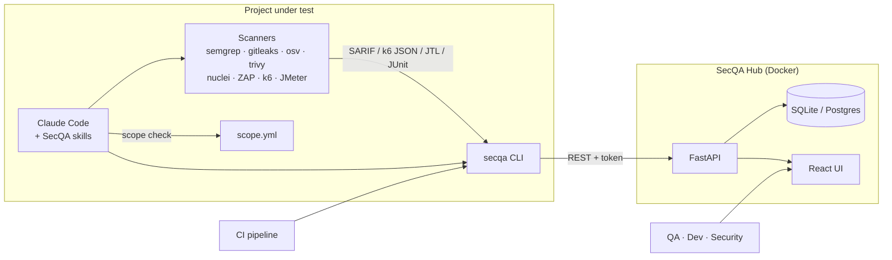
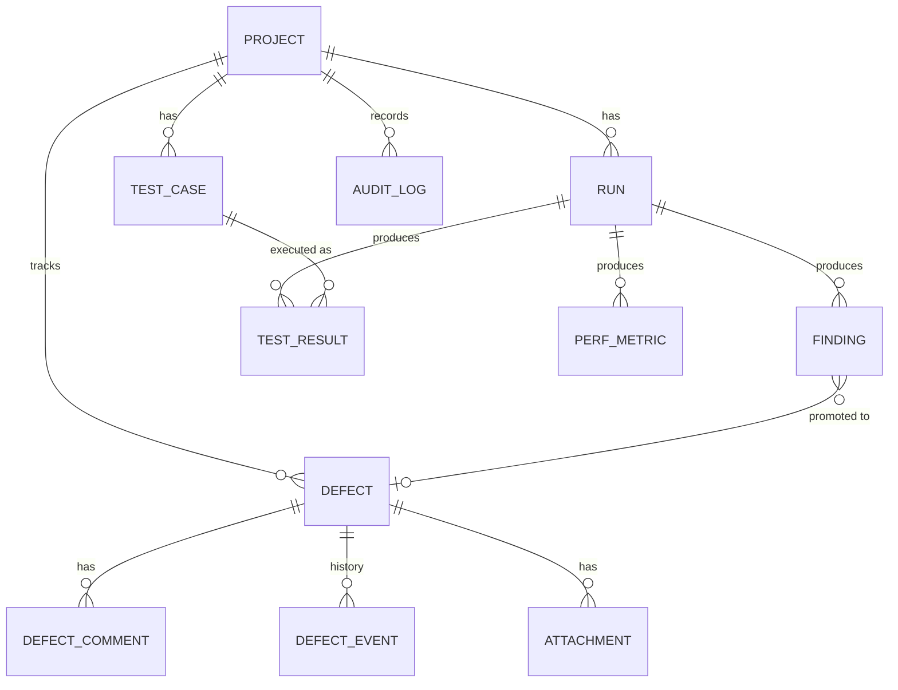

# Architecture

## Components

| Component | Path | Role |
|---|---|---|
| Agent skills | `agent-kit/skills/` | Teach Claude Code each phase (recon, SAST, SCA, secrets, API, DAST, perf, report). They never write to the database directly — only through the CLI. |
| Perf kit | `agent-kit/perf/` | Data-driven k6 scenario with capped load profiles; JMeter starter plan. |
| CLI | `src/secqa/cli.py` | `secqa init / run / ingest / finding / audit / scope …`. Light dependencies (`httpx`, `pyyaml`) so it can live in any project or CI job. |
| Hub API | `src/secqa/hub/` | FastAPI + SQLAlchemy 2 + Alembic. Parses uploads, de-duplicates findings, runs the defect lifecycle, compares performance against baselines. OpenAPI docs at `/api/docs`. |
| Hub UI | `frontend/` | React + TypeScript SPA served by the Hub. |

## Domain model

- **Run** — one execution: `security`, `performance`, `functional` or `manual`. Stores target, branch, commit, the `scope.yml` snapshot and the recon stack.
- **Finding** — raw tool output awaiting triage (`new → confirmed | false_positive | accepted_risk | duplicate`). Each has a **fingerprint** (SARIF `partialFingerprints` when available, otherwise a hash of tool, rule, location and title).
- **Defect** — the tracked work item: `bug`, `vulnerability`, `incident` or `performance`. Key `PROJ-n`, severity and priority, assignee, SLA due date, comments, attachments and a field-level history.
- **Test case** — reusable check (`PROJ-TC-n`) with steps, expected result and OWASP/CWE/ISO references. JUnit results whose name contains `[PROJ-TC-n]` link to it automatically.
- **Perf metric** — p50/p90/p95/p99, average, throughput and error rate per endpoint (`__total__` = whole run).

## Behaviours worth knowing

| Behaviour | Rule |
|---|---|
| Duplicates within a run | Same fingerprint twice in one run → skipped. |
| Remembered triage | A finding whose fingerprint was marked `false_positive` / `accepted_risk` in an earlier run inherits that status (`system:auto-suppress`). |
| Regression reopen | If a finding linked to a `fixed`, `verified` or `closed` defect reappears, the defect goes back to `new` with a history entry. |
| SLA | `due_at = created_at + SLA days by severity` (7 / 30 / 90 / 180 by default). Changing the severity recalculates it. A defect breaches SLA if it is still open after `due_at`, or was resolved after it. |
| Perf regression | After each k6/JTL ingest, every endpoint is compared with the project's baseline run: p95, p99 and average latency or throughput worse than the tolerance (10 %), or error rate up by more than max(1 percentage point, tolerance × baseline rate). A `performance` defect is opened unless `--no-defects`. |
| Run status | `finish` without `--status` infers it: perf → failed if thresholds or baseline fail; runs with test results → failed if any failed or errored; otherwise `completed`. |
| Reports | Only `confirmed` findings and defects — untriaged tool output never leaves the Hub. |

## Compliance mapping

`src/secqa/data/iso_owasp_map.json` maps each finding category to OWASP Top 10 2021 / API Top 10 2023, CWE and ISO/IEC 27001:2022 Annex A control IDs. `frameworks.json` lists the items shown in the Compliance matrix. A row is:

- **fail** — open defects mapped to it
- **warn** — open findings, no defect yet
- **pass** — test cases exist and nothing open
- **untested** — no coverage

ISO/IEC 27001 text is copyrighted; only control IDs and short titles are referenced.
